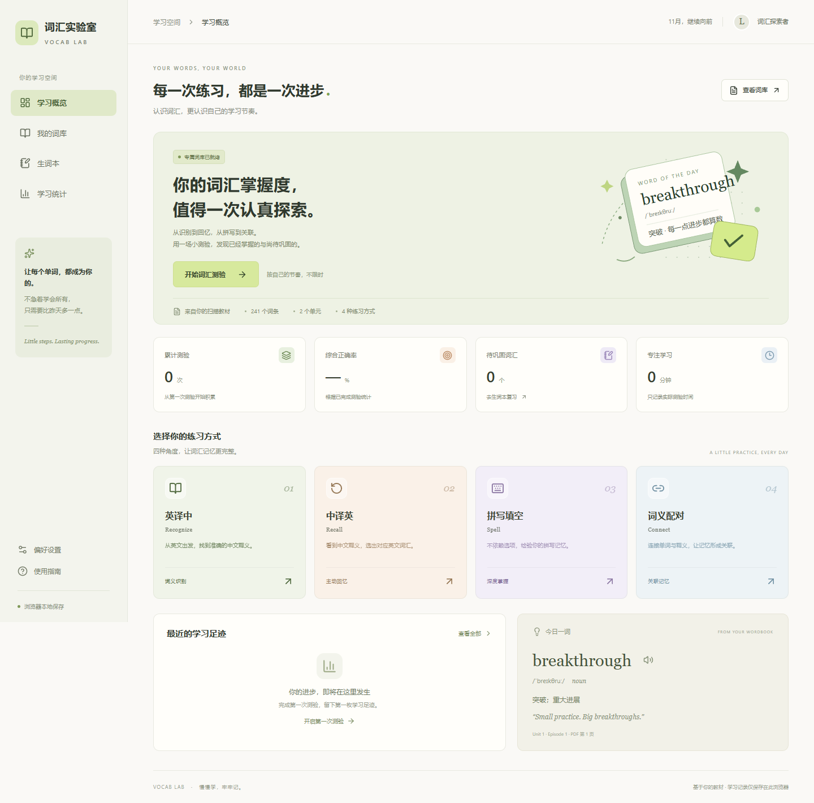
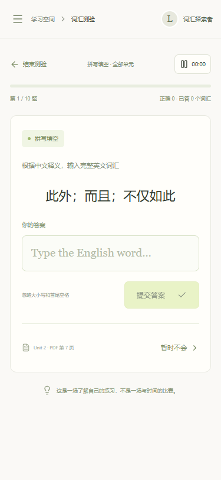

# 词汇实验室 · Vocab Lab

> 每一次练习，都是一次进步。Little steps, lasting progress.

一个纯前端的英语词汇练习应用：**课本词库 + 四级大纲 + 翻译词汇**三套词库，六种练习方式（含四级真题的选词填空与翻译），答完即时反馈、错词自动进生词本，可选用邮箱账号把记录同步到云端。

**在线体验**：[vocab-lab-egf.pages.dev](https://vocab-lab-egf.pages.dev/)（Cloudflare Pages）　·　[GitHub Pages 镜像](https://lyl-creator.github.io/vocab-lab/)　·　**使用指南**：[/guide/](https://vocab-lab-egf.pages.dev/guide/)　·　**单文件版**：[vocab-lab.html](https://vocab-lab-egf.pages.dev/vocab-lab.html)（下载后双击即可离线使用）



## 为什么做这个

背单词软件大多用通用词表，而我需要练的是**教材里的词**，以及**四级真题里的选词填空和翻译**。市面工具要么不支持自建词库，要么把"练习"做成打卡任务。

所以取舍很明确：

- **词库优先**：课本 241 条逐个人工核对，保留页码和栏目来源；四级 4428 词、翻译 548 条也从真题与大纲整理。
- **练习而不是考试**：不限时、不排名，每题即时反馈，答错只是"这个词值得再看一次"。
- **数据归自己**：默认只存在本机浏览器；需要多设备时才登录账号同步，且可以随时导出 JSON。

## 功能

| 模块 | 说明 |
| --- | --- |
| 三套词库 | 课本（241 词 / 2 单元 × 4 栏目）、四级（4428 词，577 高频）、翻译词汇（548 条 / 11 主题）；生词本、统计、顺序进度**按词库独立** |
| 六种练习 | 英译中、中译英、拼写填空、词义配对、选词填空、翻译题 |
| 四级真题 | 选词填空 12 套（2024.06 / 2025.06 / 2025.12 / 2026.06）、翻译题 15 套（多出 2024.12）；可随机，也可指定年份 + 套次 |
| 测验设置 | 范围（单元 / 栏目 / 分组 / 只考高频）、词数滑块 + 数字输入、可选只抽待巩固生词 |
| 即时反馈 | 正误提示、正确答案朗读（Web Speech API）、可选的作答提示音；答完可回车进入下一题 |
| 我的词库 | 中英文搜索、范围筛选、逐词朗读；每行 ▶ 可从该词开始顺序练习；桌面端悬停有提示 |
| 生词本 | 错题自动归档并累计错次，可标记"已掌握"或只复习待巩固词 |
| 学习统计 | 累计测验、综合正确率、近 7 天节奏、最近 100 次记录与每次的详细报告 |
| 测评报告 | 得分、答对词数、用时、平均每词耗时、逐题回顾、掌握度建议 |
| 每日一词 | 首页每天轮换一个激励向四级词，配一句英文励志短句 |
| 账号与同步 | 邮箱 + 密码登录，可改昵称、头像、密码；登录后自动拉取/上传，真冲突时让你选合并或覆盖 |
| 数据备份 | 导出 / 导入 JSON（合并或覆盖），换设备或重装浏览器时用 |
| 离线可用 | 单文件版内联全部资源；多页面版是静态站点，可整站下载 |
| 响应式 | 320–1920px 无横向溢出，移动端抽屉导航，答题页一屏可见四个选项 |

<p>
  
  
</p>

## 词库与真题数据

| 数据集 | 数量 | 说明 |
| --- | --- | --- |
| `src/vocabulary.ts` | 241 词 | 课本 9 页扫描件转录，含 `en/zh/pos/unit/section/page/phrase`，160 个四级词标 ★，42 个短语 |
| `src/data/cet4.ts` | 4428 词 | 四级大纲，含音标与 `high` 标记（577 个高频词） |
| `src/data/translation.ts` | 548 条 | 四六级翻译常用表达，11 个主题分组 |
| `src/data/exams.ts` | 12 + 15 套 | 真题选词填空（10 空 / 15 候选词）与翻译题（原文 + 参考译文 + 按年份取自解析的点拨） |
| `src/passages.ts` | 8 篇 | 课本选词填空用的课文原文 |

> 教材扫描原件（`source/*.pdf`、`source/page-*.png`）属于出版方版权内容，**不随仓库分发**；仓库只保留转录后的词汇数据与界面截图。

## 技术栈

- **React 19** + **TypeScript 5.9**，函数组件与 hooks，无状态管理库
- **Vite 7** 构建，`base: './'` 以便部署在子路径
- **Tailwind CSS 3** + **shadcn/ui**（Radix 原语），`lucide-react` 图标
- **Web Speech API** 朗读、**Web Audio** 提示音、**localStorage** 持久化
- **Supabase**（Auth + Postgres + RLS）做可选的账号与云同步，SDK 从 CDN 动态加载
- **Playwright** 做端到端校验（`verify.mjs`、`scripts/verify-exams.mjs`）

## 快速开始

```bash
npm install          # 安装依赖
npm run dev          # 开发服务器 http://127.0.0.1:5173
npm run build        # tsc -b && vite build → dist/
npm run preview      # 预览生产构建
npm run lint         # ESLint
```

## 构建与发布

站点是**多页面静态站点**，构建产物在 `docs/`，可以同时发布到 GitHub Pages 与 Cloudflare Pages（见 [CLOUDFLARE.md](CLOUDFLARE.md)；后者在国内通常更快，且支持从源码自动构建）。完整流程：

```bash
npm run build             # 1. 生成 dist/
node build-pages.mjs      # 2. dist/ → docs/：43 个静态页面 + 404 + sitemap.xml + robots.txt + 图标
node build-standalone.mjs # 3. dist/ → vocab-lab.html 单文件版
git add docs vocab-lab.html && git commit -m "build: 更新站点" && git push
```

说明：

- `build-pages.mjs` 为每个路由生成带独立 `title` / `description` / `og` / canonical 的 HTML；深层页面用相对路径引用资源，404 页用站点绝对路径；
- 图标（`favicon.ico` / `favicon.svg` / `apple-touch-icon.png` / `icon-192/512.png`）从 `public/` 复制进 `docs/`，并在每个页面注入正确的链接；
- 单文件版把 JS、CSS 和图标都内联，适合离线使用或直接发给别人。

本地预览多页面站点要起一个静态服务器（`file://` 下模块脚本会被 CORS 拦住）：

```bash
npx serve docs
```

## 路由

使用真实路径（History API），不是 hash；每个路径都有对应的静态页面：

| 路径 | 页面 |
| --- | --- |
| `/` | 学习概览 |
| `/book/`、`/book/u1/episode-1/` | 课本词库 / 指定单元与栏目 |
| `/cet4/`、`/cet4/high/` | 四级词库 / 只考高频 |
| `/translation/`、`/translation/中国历史/` | 翻译词汇 / 指定主题 |
| `/<词库>/<练习方式>/` | 例如 `/cet4/cloze/`、`/book/spelling/`，打开即进入该练习的设置 |
| `/cet4/cloze/2025-12-2/` | 预选某一套真题 |
| `/notebook/`、`/history/`、`/guide/` | 生词本、学习统计、使用指南 |

旧版 hash 链接（`#/cet4/high`）会自动跳转到新地址。

> 部署到 Cloudflare Pages 时 `SITE_ORIGIN` 设为该站点域名，生成的 canonical 与 sitemap 会指向它；仓库里的 `docs/` 默认仍按 GitHub Pages 的子路径构建。

## 目录结构

```
.
├── index.html                 # Vite 入口
├── src/
│   ├── main.tsx               # 挂载 React
│   ├── App.tsx                # 全部页面与交互（概览 / 词库 / 生词本 / 统计 / 答题 / 报告 / 设置）
│   ├── router.ts              # 路径解析与生成
│   ├── engine.ts              # 出题、判分、生词本、存储读写与迁移
│   ├── sync.ts                # Supabase 登录、拉取/推送、合并、资料与密码
│   ├── transfer.ts            # 备份导出/导入与校验
│   ├── daily.ts               # 每日一词（60 个激励词 + 句子）
│   ├── Guide.tsx              # 使用指南页面
│   ├── dicts.ts               # 三套词库的元信息与题型映射
│   ├── vocabulary.ts          # 课本词库（241 条）
│   ├── passages.ts            # 课本选词填空原文
│   ├── data/                  # cet4.ts / translation.ts / exams.ts
│   ├── App.css                # 页面样式（含响应式、存储提示、组件微调）
│   └── components/ui/         # shadcn/ui 组件
├── public/                    # favicon.svg / favicon.ico / apple-touch-icon / icon-192/512
├── build-pages.mjs            # 生成 docs/ 多页面站点
├── build-standalone.mjs       # 生成 vocab-lab.html
├── verify.mjs                 # Playwright 端到端校验
├── scripts/                   # 真题数据校验与构建辅助
├── source/                    # 界面截图（教材原件已排除）
└── docs/                      # 发布到 GitHub Pages 的产物
```

## 数据与存储

本地数据都在 `localStorage`：

| 键 | 内容 |
| --- | --- |
| `vocab-lab-v1` | 主数据：测验历史、生词本、进行中的测验、设置、云端同步状态 |
| `vocab-lab-dict` | 当前选择的词库 |
| `vocab-lab-seq` | 每个词库的顺序练习进度 |
| `vocab-lab-profile` | 昵称与头像 |
| `vocab-lab-sync-email` | 上次登录的邮箱（只用于回填输入框） |

- 记录按词库隔离：测验、生词本、顺序进度都带 `dict` 字段，切换词库只显示对应数据；旧版本记录在读取时按 id 前缀迁移。
- 浏览器给单站的 localStorage 约 **5MB**（实测 5,242,875 字符）。写满时会依次裁剪最旧记录并提示，仍写不下才提示"未能保存"；启动时还会请求 `navigator.storage.persist()` 降低被回收概率。
- 换设备：偏好设置 → 导出 JSON；新设备 → 导入（合并按测验 id 去重，覆盖则整份替换）。

## 账号与云同步（可选）

不登录也能完整使用。登录后：

- 登录时拉取云端记录，每完成一局自动上传；面板里有"立即同步"；
- 两边各有对方没有的记录时才弹冲突窗口，可选**合并两边** / 云端覆盖本地 / 本地覆盖云端；内容相同时不打扰；
- "清空学习记录"会同时清空云端。

后端是 Supabase：表 `vocab_sync`（`user_id` 主键、`payload jsonb`、`updated_at`），开启 RLS，三条策略都限定 `auth.uid() = user_id`。项目地址与 anon key 在 `src/sync.ts`（anon key 本就是公开信息，安全依赖 RLS）。自建步骤见 [SYNC-SETUP.md](SYNC-SETUP.md)。

## 规则细节

- 选择题**按首次作答计分**，跳过记为错误；
- 拼写题标注是单词还是短语，忽略大小写与首尾空格，含 `sb.` / `sth.` 等占位符的短语不参与拼写；
- 选词填空：课本从所选栏目的课文里挖 10 空；四级直接用真题（10 空 / 15 候选词），按原文词形判分；
- 配对题每组最多 4 个词，按首次配对计分，配错后可继续尝试但错词立即进生词本；
- 复习模式答对一次错次 −1、答错 +1，减到 0 自动移出生词本；
- 刷新页面会恢复进行中的测验；未完成的测验不计入统计；
- 答题时回车进入下一题（输入框、文本框内不拦截）；"下一题"按钮在答题卡右上角，未作答时置灰。

## 隐私与安全

- 不加载统计或广告脚本；未登录时数据不离开浏览器。
- 网络请求只有两类：登录/同步时访问 Supabase，以及首次加载 Supabase SDK（unpkg）。
- 渲染全部走 React 文本转义，没有 `dangerouslySetInnerHTML`；导入的 JSON 会先校验结构。
- 密码由 Supabase Auth 处理，前端不保存密码，只保留 SDK 管理的会话 token。

## 已知限制

- 账号不绑定邮箱验证，**忘记密码无法自助找回**（可重新注册后用导出的 JSON 恢复数据）；
- Supabase SDK 从 CDN 加载，首次打开需要网络；完全离线请用 `vocab-lab.html`；
- 还没有 Service Worker，多页面版不支持整体离线缓存；
- 数据量受 localStorage 限制（见上文），尚未迁到 IndexedDB。

## 关于评估口径

报告中的正确率反映的是**本次抽测**的掌握情况，不等同于 CEFR 等级，也不代表总词汇量。

## 许可

个人学习项目，代码可自由参考。词库内容来自本人教材与公开真题，扫描原件与真题原文不随仓库分发。
